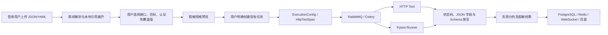

# Req2Test Agent 第三轮P1-A接口测试增强与验收报告

日期：2026-10-15（Asia/Shanghai）。范围：P1-A 最终验收、独立提交、PR、CI 核实和报告；未启动 P1-B/P1-C/P2，未合并或部署。

## 1. 版本和交付结论

- 开发分支：`feature/api-testing-enhancement`。
- 已验收实现提交：`443e566d3620d0c322b295f30f249947525bde1c`；实现 tree：`1e85f0e3a0897b2338baa3a4ca97a23f3eecd431`。
- 本地初始实现提交 `387eb8e61cd9f05d79e40c65a060bfecddba9b61` 与远端实现 tree 完全一致，仅提交元数据不同。本地原提交保留在 `codex/p1a-local-verified-20261015`，当前开发分支已安全对齐远端。
- [P1-A PR #6](https://github.com/xingqianyue268-alt/req2test-agent/pull/6)，Open，禁止自动合并。
- [安全整改 PR #5](https://github.com/xingqianyue268-alt/req2test-agent/pull/5) 核实时仍未合并。因此 #6 的 base 为 `feature/security-hardening`，base SHA 为 `9332c0ddf3df9a67d573ceef16f2edbdce886447`，只展示本轮增量，不将 P0 代码重复计为 P1-A。
- #5 合并后，由后续获授权的维护操作将 #6 base 改为 main，再核实差异及 CI。本任务不提前改变依赖关系。
- 本地验收通过：**369 passed / 0 failed / 0 skipped / 0 error**，原有 293 + 新增 76。
- GitHub CI 状态见第 7 节；文档与证据提交不改变上述实现快照。

原部署工作区 `/Users/xing/Desktop/req2test-agent-release-check`、部署分支及未提交 `railway.json` 均保留。本轮在独立工作区 `/Users/xing/Desktop/req2test-api-testing-enhancement` 完成。没有 reset --hard、clean -fd、强制推送或生产数据操作。

## 2. 已实现并验证的功能

### 422 判断一致性

根因是 HTTP Tool 把任何 422 直接加入失败列表，诊断证据收集也无条件将 422 归为错误。修复后，状态码是否符合规格决定断言结果；仅非预期 422 保留契约错误证据。

- 预期 422 / 实际 422：HTTP 与 Pytest 均通过，无错误诊断。
- 预期 200 / 实际 422：HTTP 与 Pytest 均失败，HTTP 诊断保留 `contract_mismatch`。
- 401、403、404、500 的预期/非预期状态仍可区分，原有 Timeout、连接错误、Failure Analyzer 和 Evaluation Center 测试保持通过。
- 先写回归测试：首批契约测试修复前为 **11 failed / 8 passed**；修复后通过。OpenAPI 新功能初始测试因模块尚不存在报 collection error，此项仅为开发起点，不作为缺陷复现数量。

### 标准 JSON 请求解析

用 `JSONDecoder.raw_decode` 按完整 JSON 值消费文本，正则仅定位接口与字段标记，不截取 JSON 对象边界。支持嵌套对象、数组、布尔、null、转义、多行 JSON；JSON 内的 `GET /...` 文本不会生成额外接口。

错误 JSON、尾随垃圾、NaN/Infinity 明确拒绝并给出行列位置，不吞异常，不回显原始敏感输入。兼容旧的无冒号状态码描述。`json_body_present=true` 可明确发送 JSON `null`；旧的 `json_body=None` 仍代表无请求体。

### OpenAPI 导入与执行

新增 `/contracts` 页面、`/api/v1/contracts/import` 和 `/api/v1/contracts/preview`。文件采用现有上传约定 `filename + content_base64`，用户明确选择接口、目标地址和认证信息，再创建任务。导入和预览不执行请求，不读取远端引用，不自动使用文档 `servers`。

现有 `/api/v1/tasks` 接受 `openapi_contract`，编译成既有 `ExecutionConfig` 与 `HttpTestSpec`，继续复用任务持久化、RabbitMQ、Celery、HTTP Tool、Pytest Runner、失败分析、Redis/WebSocket 和导出路径。未新增数据库表或另一套执行框架。

原始上传文件不进入任务持久化或 LLM；实际执行认证保留到执行输入，公开预览和结果脱敏。原 P0 目标白名单、禁止重定向、Cookie Origin、Bearer 兼容和 Celery 脱敏回归均保留。新入口的参数错误还移除了可能含编码文档或认证覆盖值的校验回显。

## 3. OpenAPI 支持范围和限制

| 能力 | 本阶段范围 |
|---|---|
| 版本/格式 | 3.0.x、3.1.x；JSON、YAML/YML；UTF-8 |
| 路径与方法 | GET、POST、PUT、PATCH、DELETE、HEAD、OPTIONS；路径参数替换 |
| 参数 | path/query/header 简单标量；required、类型、enum 和可生成的常见数值/长度约束 |
| 请求/响应 | application/json；明确的响应状态码；嵌套对象、数组、布尔、null；响应 Schema 与显式 JSON 字段断言 |
| 引用 | `#/components/…` 本地引用、JSON Pointer 转义、深度与展开量限制 |
| 基础测试 | 正向；声明 400/422 时生成顶层必填字段缺失、一个字段类型错误、必填 query 缺失 |
| 执行范围 | 单文件 1 MiB、200 接口；单任务 20 用例，超出明确拒绝，不静默截断 |
| 明确不支持自动执行 | oneOf/allOf/anyOf、循环/外部引用、format/pattern、复杂参数序列化、multipart、OAuth 自动取令牌、3.2、Path Item 引用、仅有 default/范围成功响应 |

不宣称完整 OpenAPI/JSON Schema 实现。不可支持的接口展示诊断并拒绝执行；复杂约束不能自动生成有效样例时要求用户提供覆盖值。readOnly/writeOnly 的完整方向语义、业务前置依赖及自动提取令牌串联未充分实现，不能当作通用业务链编排器。认证由用户显式配置，不会自动执行 OAuth。

新增显式依赖仅 PyYAML 和 jsonschema（原依赖树已有）：前者安全解析 YAML，拒绝别名和非标准对象构造；后者供两个执行器共用响应断言，引用在导入时离线展开，执行器不解析外部引用。

两个执行器同时启用会发送两轮请求。写接口必须使用隔离、可重复的数据；样例输入不保证符合任意目标的业务规则。敏感字段脱敏遵循既有字段策略，不保证识别任意无标签秘密或完整 PII。

## 4. Mock API 与浏览器实测

`examples/mock_api.py` 仅使用虚构数据，可用 `uvicorn examples.mock_api:app --host 127.0.0.1 --port 8081` 启动。JSON/YAML 契约位于 `examples/openapi/`。

| 接口 | 生成用例数 | 场景 |
|---|---:|---|
| POST /login | 4 | 虚构登录、两个必填缺失、错误类型 |
| GET /users/{user_id} | 1 | 显式合成 Bearer、路径参数、响应字段 |
| GET /products | 1 | query、数组响应 |
| POST /products | 5 | 201、嵌套 JSON、三个必填缺失、类型错误 |
| POST /validate | 6 | 正向、三个必填缺失、类型错误、query 缺失 |
| 合计 | 17 | 每个执行器独立执行一轮 |

JSON 与 YAML 两种文件都通过真实 loopback HTTP / 生成 Pytest 集成测试。示例契约对 FastAPI 自动生成的错误位置组合类型作了明确简化，不等于自动支持任意框架的全部 OpenAPI 输出。

2026-10-15 通过 Codex 内置浏览器实际操作：登录 → 文件选择器上传 YAML → 展示 5 个默认未选接口 → 选择 5 接口 → 填写 loopback 目标及虚构认证 → 预览确认令牌不出现在输出 → 点击创建任务 → 刷新任务详情查看完成。任务 `6be7dfaa-c730-4438-8f31-6f433cf21163`：HTTP 17/17、Pytest PASS / exit 0、诊断 0。页面明确显示预期 422 / 实际 422 通过。现有任务详情页需要刷新看到完成状态，未扩大范围重构页面。

## 5. 测试统计与证据

| 测试集合 | passed | failed | skipped | error |
|---|---:|---:|---:|---:|
| 最终本地完整 pytest | 369 | 0 | 0 | 0 |
| 其中原有 P0 完成后的测试 | 293 | 0 | 0 | 0 |
| 新增状态码/JSON 解析 | 31 | 0 | 0 | 0 |
| 新增 OpenAPI 解析/生成/边界 | 31 | 0 | 0 | 0 |
| 新增真实 HTTP/Pytest 集成 | 7 | 0 | 0 | 0 |
| 新增 PostgreSQL API 入口/安全 | 7 | 0 | 0 | 0 |

完整集合中 `tests/db` 为 87 项，包含数据库相关纯单元测试；此前数据库停机时其中 75 项依赖实际 PostgreSQL 的测试被跳过，本次服务恢复后全部实际通过。1 条既有 Starlette/anyio 弃用警告，不影响结果。

恢复历史必须区分：此前 365 全通过后增加了 4 项边界测试，最后一次中断记录是 **294 passed / 75 skipped**，不是 369 通过；原因是 Docker 停止。恢复服务并更新映射端口后的 `restored-final.log/.xml/.json` 才是当前最终 369 全通过依据。没有删除、跳过或弱化安全测试。

独立真实服务 smoke 验证 PostgreSQL、Redis、RabbitMQ、Celery、API、Chroma：原有 Demo 正向和非预期 422、OpenAPI 17 条用例、登录退出、Cookie/Bearer、RBAC、知识库上传查询删除/重建、WebSocket、结果和 Worker 日志脱敏均通过。复用 `scripts/smoke_security.py --openapi`；`scripts/smoke_openapi.py` 是受限测试入口，只接受 test 模式、loopback 服务和专用 `req2test_p1a_test` 数据库。

Evaluation Center 和离线 Golden Dataset demo：**3 个样本，98.45/100，门槛 80**。这是确定性 Demo 评测得分，**不是模型准确率**。真实 LLM API Key、真实模型质量及线上负载未验证；原有 AI 适配器、出站脱敏和失败处理由自动化回归覆盖。

完整本地证据目录：`/Users/xing/Desktop/Req2Test-P1A-evidence-20261014/`。可分享的验收摘要见 `docs/p1a-evidence/validation-summary.json`；不提交原始运行日志、测试数据库、浏览器账户或环境文件。

## 6. 文件与主要函数

- `http_tool.py:HttpApiTestTool.invoke`、`diagnostics/evidence.py`：422 判断、诊断及 Schema 断言。
- `contract_parser.py:extract_explicit_http_specs/_json_value`：标准 JSON 解析；`tool_calling.py` 保留原导入接口兼容。
- `openapi_import.py:parse_document/compile_plan/_Resolver/_schema/_sample`：离线解析、边界、引用与规格生成。
- `schema_assertions.py:schema_failures`：共享断言、禁止外部引用、诊断不回显值。
- `execution_models.py:HttpTestSpec/request_body_kwargs`、`pytest_runner.py:render_pytest_module`：Schema 规格与显式 null。
- `api.py:import_contract/preview_contract/create_task/sanitized_validation_error`：鉴权入口及现有任务派发。
- `contracts_ui.py:render_contracts_html`、`demo_ui.py`：轻量操作页面及一个导航入口。
- `examples/mock_api.py`、两份契约、4 个新增测试模块、两个 smoke 入口：可复现验证。
- `pyproject.toml`、README：依赖和使用说明。无数据库迁移。

## 7. Ruff 与 GitHub CI

Ruff 基线 137 → 最终 137；按文件、规则及信息比对，新增 0、移除 0。退出码为 1，仍有历史诊断，不声称静态检查全绿。`git diff --check` 通过。

实现提交的两次 CI 均已成功，并逐项核对日志：

| 事件 | 工作流 | 测试 | 评测 | 构建 |
|---|---|---|---|---|
| push | [38608917831](https://github.com/xingqianyue268-alt/req2test-agent/actions/runs/38608917831) | 369 passed，0 failed/skipped/error，45.15s | 3 样本，98.45 | 成功 |
| pull_request | [38608972942](https://github.com/xingqianyue268-alt/req2test-agent/actions/runs/38608972942) | 369 passed，0 failed/skipped/error，51.02s | 3 样本，98.45 | 成功 |

PR base/head 已核对，仅 22 个实现相关变更文件；后续报告提交只增加文档及验收摘要。GitHub 判定 mergeable=true。交付文档提交产生的新 CI 状态，以 PR Checks 及最终本地报告补记为准，不能把实现提交的成功冒充后续 SHA 的结果。

CI 的 pytest + PostgreSQL + deterministic evaluation gate 与本地真实 RabbitMQ/Redis/浏览器 smoke 是不同证据；现有 CI 没有运行 Ruff，也没有完整浏览器/消息队列服务 smoke。不能把本地验证宣称为 CI 已执行。

## 8. 残留限制、回滚与下一阶段

无本地验收阻塞；未测试生产、多浏览器矩阵、压力/并发、大型复杂企业契约和真实模型。OpenAPI 支持限制及重复写入风险见第 3 节。当前完整流程可用于项目演示和代码审查，不能宣称企业生产成熟度。

PR 未合并时可直接不合并/关闭本 PR；若后续维护者合并，使用普通 revert 撤回本轮提交，并保留 P0，不通过强制回退改写共享历史。本轮无数据库结构变更。回滚不是关闭安全防护。

P1-B 建议（仅建议，未开发）：显式数据集驱动与参数化用例标识、可重复数据准备/清理、执行批次追溯、JUnit 导出及失败映射。之后再单独评估业务链变量提取、多浏览器自动化、更多 Schema 组合支持；不要将这些写成已实现能力。
